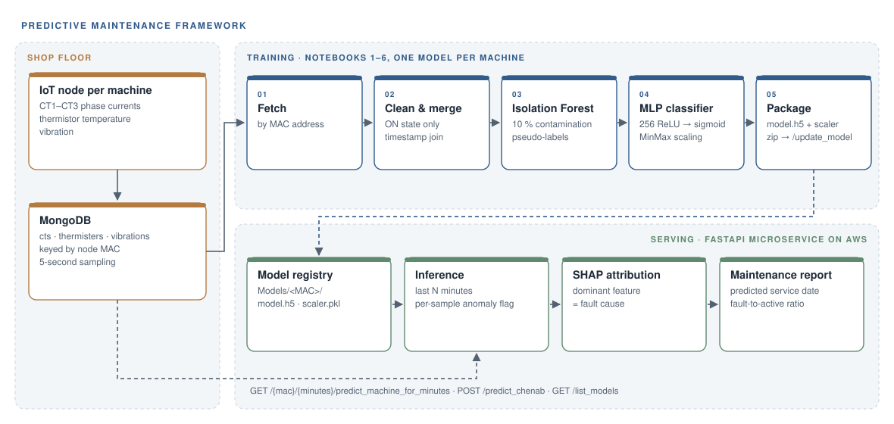
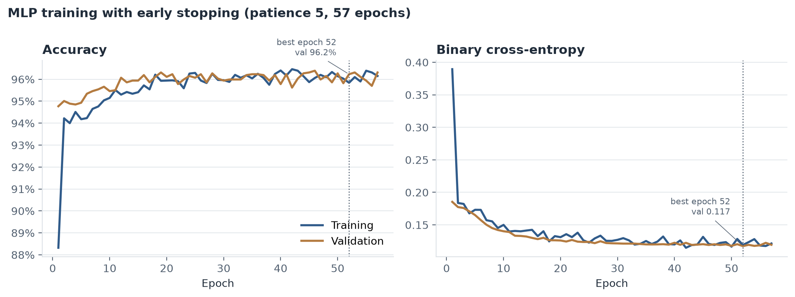
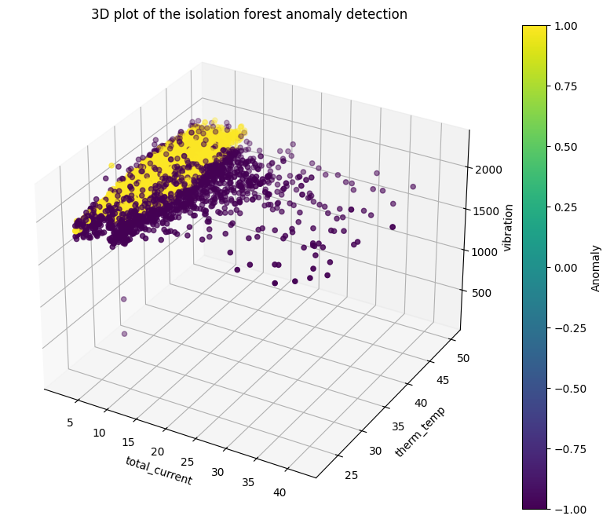
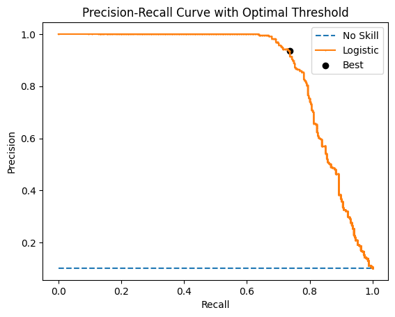

<div align="center">

# Predictive Maintenance Microservice

**Machine-specific anomaly detection, root-cause attribution and maintenance forecasting for industrial equipment, served as a containerised FastAPI microservice.**


</div>

Developed during an ML internship at the **Center for Advanced Research in Engineering (CARE), Islamabad** for an industrial IoT monitoring platform. This repository is the **serving half** of the framework. Model development lives in [Predictive-Maintenance-Model-Training](https://github.com/danishzulfiqar/Predictive-Maintenance-Model-Training).

## The problem

Each machine on a production floor (drills, lathes, compressors) is fitted with an IoT node that streams **three phase currents, temperature and vibration** every few seconds. Operators want to know three things: *is this machine behaving abnormally right now, why, and when should it be serviced?*

Two facts make this hard:

1. **There are no failure labels.** Machines rarely fail, and when they do the event is not recorded in a form a model can learn from.
2. **"Normal" is machine-specific.** A current draw that is routine for a heavy drill is alarming for a small lathe, so one global model would raise false alarms on some machines and miss real problems on others.

## Approach

<p align="center"></p>

**One model per machine.** Each machine is identified by the MAC address of its IoT node and gets its own model and scaler, stored under `Models/<MAC>/`. New or retrained models are uploaded as a zip through `POST /update_model` and become available immediately, with no redeploy.

**Labels without labelling.** The training pipeline first fits an **Isolation Forest** (10 % contamination) on the machine's historical ON-state telemetry. Isolation Forest isolates points that are easy to separate from the bulk of the data and marks them as anomalous. It needs no failure history, which makes it a good fit here.

**A fast, explainable detector.** A compact **MLP** (7 inputs → 256 ReLU → sigmoid) is then trained on those pseudo-labels. Distilling the forest into a differentiable network has two benefits:

- inference over a window of readings is a single batched forward pass;
- **SHAP** attributions can be computed for every flagged sample. The service reports the feature with the largest absolute SHAP value as the probable **fault cause** (for example `vibration` or `CT2`), which turns an anomaly flag into something a technician can act on.

**From anomalies to a maintenance plan.** The anomaly count in the analysed window is converted into a **predicted maintenance date**, brought forward from the scheduled date in proportion to the number of anomalous readings, together with a **fault-to-active ratio** and a **degraded-life** indicator.

## Model performance

The figures below come from training on one production machine: **15,409** merged ON-state samples, of which 1,541 were flagged anomalous.

<p align="center"></p>

<table>
<tr>
<td width="50%"></td>
<td width="50%"></td>
</tr>
<tr>
<td><sub>Isolation Forest decision in current × temperature × vibration space (−1 = anomalous). Unusual current draw combined with low vibration stands out clearly.</sub></td>
<td><sub>Precision–recall on the 20 % test split. Best F1 = 0.824 at a threshold of 0.563. Precision stays ≈ 1.0 up to ≈ 65 % recall.</sub></td>
</tr>
</table>

| Metric (held-out 20 %) | Value |
|---|---|
| Accuracy against Isolation Forest labels | **96.5 %** |
| Best F1 (threshold 0.563) | **0.824** |
| Best validation loss (epoch 52 of 57, early stopping) | 0.117 |

The precision-first operating point is intentional on a shop floor: a false alarm costs an unnecessary inspection, and frequent false alarms teach operators to ignore the system.

## API

Interactive documentation is available at **`/docs`** (Swagger UI).

| Method | Route | Purpose |
|---|---|---|
| `GET` | `/` | Health check |
| `GET` | `/{mac}/{minutes}/predict_machine_for_minutes` | Pull the last *N* minutes of telemetry for a machine from MongoDB, run its model and return the analysis |
| `GET` | `/{mac}/{minutes}/get_interval_data` | Return the merged telemetry window without predicting |
| `POST` | `/predict_chenab` | Analyse telemetry posted in the request body (see below) |
| `POST` | `/update_model` | Upload `<MAC>.zip` containing `model.h5` and `scaler.pkl` |
| `GET` | `/list_models` | List machines that have a deployed model |

<details>
<summary><b>Example request and response</b></summary>

```bash
curl -X POST http://localhost:8000/predict_chenab \
  -H "Content-Type: application/json" \
  -d '{
        "maintenance_date": "02/12/25",
        "data": [
          {"CT1": 1.38,  "CT2": 1.58,  "CT3": 1.36,  "CT_Avg": 1.44,  "total_current": 4.33,  "therm_temp": 25.0,  "vibration": 1901},
          {"CT1": 1.43,  "CT2": 1.46,  "CT3": 1.46,  "CT_Avg": 1.45,  "total_current": 4.35,  "therm_temp": 24.98, "vibration": 1898},
          {"CT1": 12.21, "CT2": 13.90, "CT3": 10.29, "CT_Avg": 12.13, "total_current": 36.40, "therm_temp": 31.8,  "vibration": 1903},
          {"CT1": 0.0,   "CT2": 11.27, "CT3": 14.65, "CT_Avg": 8.64,  "total_current": 25.92, "therm_temp": 26.4,  "vibration": 1902}
        ]
      }'
```

Response from the committed model for machine `08:D1:F9:A7:4D:FC`. These readings come from a different machine, so the model flags all four, and SHAP points at the CT2 phase current:

```jsonc
{
  "predicted": [1, 1, 1, 1],                  // per-sample anomaly flag
  "fault_cause": ["CT2", "CT2", "CT2", "CT2"],  // dominant SHAP feature per anomaly
  "faulty_predicted": 4,
  "todays_date": "11/26/26",
  "scheduled_maintenance_date": "02/12/25",
  "predicted_maintenance_date": "02/11/25",
  "degraded_life": 0.0083,
  "falutToActiveRatio": 1.0
}
```
</details>

## Running the service

### Docker

```bash
git clone https://github.com/danishzulfiqar/Micro-Service-Predictive-Maintenance.git
cd Micro-Service-Predictive-Maintenance
docker build -t pdm-api .
docker run --name pdm-api -p 8000:8000 pdm-api
```

### Local Python (3.10)

```bash
python -m venv .venv && source .venv/bin/activate
pip install -r requirements.txt --no-cache-dir
fastapi run app/main.py --port 8000
```

### Deploying on AWS EC2

The service runs comfortably on a `t2.small` Ubuntu instance (it also works on `t2.micro` at low traffic). For CPU-only hosts, replace `tensorflow` with `tensorflow-cpu` in `requirements.txt` to shrink the image, then run the Docker commands above, or `nohup fastapi run app/main.py --port 8000 &` without Docker.

## Repository layout

```
├── app/main.py               # FastAPI app: data access, inference, SHAP, maintenance logic
├── Models/<MAC>/<MAC>/       # per-machine model.h5 + scaler.pkl
├── assets/                   # architecture diagram and figures
├── Dockerfile · docker-compose.yml
└── requirements.txt
```

## Related

- **Training pipeline:** [Predictive-Maintenance-Model-Training](https://github.com/danishzulfiqar/Predictive-Maintenance-Model-Training). It covers data extraction, cleaning, isolation-forest labelling, MLP training, evaluation and one-click deployment to this service.

## Author

**Danish Zulfiqar**. [danishzulfiqar.com](https://danishzulfiqar.com) · [GitHub](https://github.com/danishzulfiqar)
