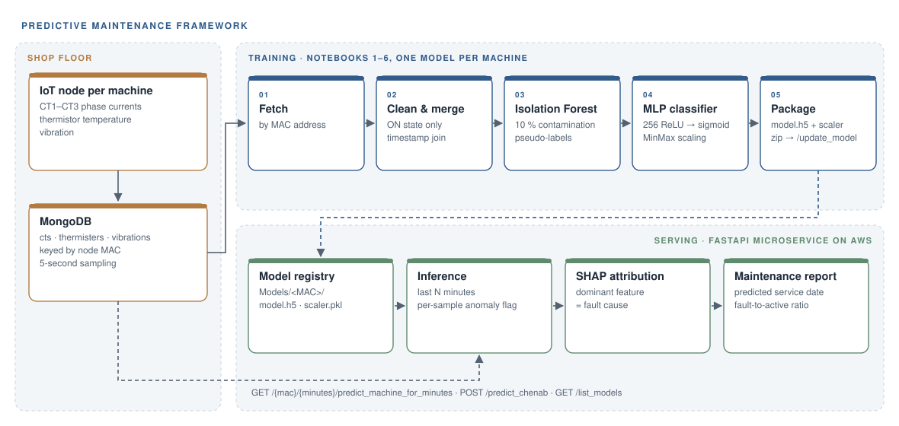
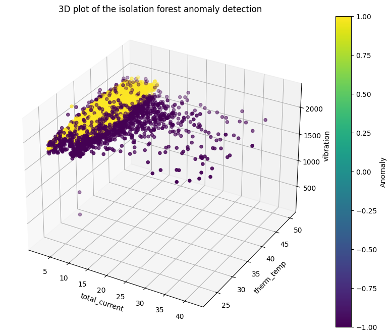
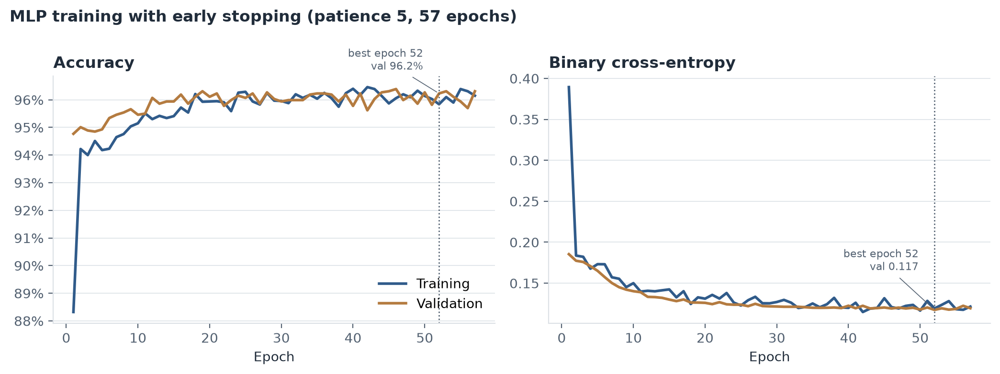
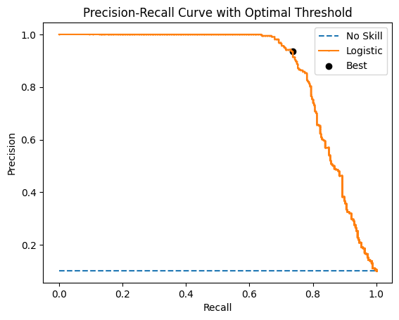
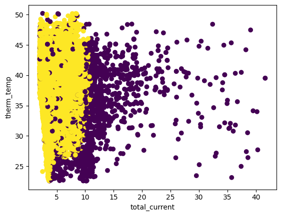

<div align="center">

# Predictive Maintenance: Model Training Pipeline

**Notebooks that turn raw machine telemetry into a deployable, explainable anomaly-detection model, one model per machine, without needing any failure labels.**


</div>

This is the **training half** of a predictive-maintenance framework built at the **Center for Advanced Research in Engineering (CARE), Islamabad**. Trained models are pushed to the serving half, [Micro-Service-Predictive-Maintenance](https://github.com/danishzulfiqar/Micro-Service-Predictive-Maintenance).

<p align="center"></p>

## Pipeline

Run the notebooks in order. Each one reads the previous stage's output folder and writes its own.

| # | Notebook | What it does | Output |
|---|---|---|---|
| 1 | [`1_getMacData.ipynb`](1_getMacData.ipynb) | Pulls the machine's current (`cts`), vibration and thermistor collections from MongoDB by node MAC address | `RawData/*.csv`, `model_data.json` |
| 2 | [`2_Pre_Data_Processing.ipynb`](2_Pre_Data_Processing.ipynb) | Keeps ON-state rows only, drops OFF/IDLE and missing values, de-duplicates timestamps and joins the three sensor streams on time | `CleanData/data.merged.csv` |
| 3 | [`3_isolated_forest.ipynb`](3_isolated_forest.ipynb) | Fits an Isolation Forest (contamination 0.1) and converts its decisions into binary pseudo-labels | `DataSet/*.csv` |
| 4 | [`4_model.ipynb`](4_model.ipynb) | MinMax-scales the 7 features and trains an MLP (256 ReLU → sigmoid, Adam, early stopping) | `Models/model.h5` |
| 5 | [`5_evaluate_model.ipynb`](5_evaluate_model.ipynb) | Re-evaluates the saved model, fits and saves the scaler, computes maintenance indicators | `Models/scaler.pkl` |
| 6 | [`6_deploy_model.ipynb`](6_deploy_model.ipynb) | Packages `model.h5` + `scaler.pkl` as `<MAC>.zip` and uploads it to the microservice's `/update_model` endpoint | live model |

**Features (7):** `CT1`, `CT2`, `CT3` (phase currents), `CT_Avg`, `total_current`, `therm_temp`, `vibration`.

## Why Isolation Forest → MLP?

Industrial machines almost never come with labelled failure data, so the pipeline **creates its own labels**. Isolation Forest scores how easily a reading can be separated from the rest of the data by random partitioning. Rare, unusual readings are isolated after only a few splits.

The forest's decisions are then **distilled into a small neural network**. The network is:

- **fast**: one batched forward pass per inference window;
- **smooth**: it gives a calibrated anomaly score that can be thresholded (precision–recall curve below);
- **explainable**: SHAP attributes each flagged reading to the sensor responsible, which the service reports as the *fault cause*.

<p align="center"></p>
<p align="center"><sub>Isolation Forest decisions for one production machine (15,409 ON-state samples; yellow = normal, purple = anomalous). The normal operating envelope is a tight, low-current band. Readings outside it are flagged.</sub></p>

## Results

Training on one production machine, with 13,868 normal and 1,541 anomalous samples and an 80/20 split:

<p align="center"></p>

<table>
<tr>
<td width="48%"></td>
<td>

| Metric (held-out 20 %) | Value |
|---|---|
| Accuracy vs. Isolation-Forest labels | **96.5 %** |
| Best F1 | **0.824** |
| Optimal threshold | 0.563 |
| Best validation loss | 0.117 (epoch 52) |
| Training samples | 12,327 |
| Test samples | 3,082 |

Precision stays close to 1.0 up to about 65 % recall, which makes a low-false-alarm operating point possible on the shop floor.

</td>
</tr>
</table>

<p align="center"></p>
<p align="center"><sub>Total current against temperature. Current draw well above the machine's normal envelope is the strongest anomaly signal.</sub></p>

## Usage

```bash
git clone https://github.com/danishzulfiqar/Predictive-Maintenance-Model-Training.git
cd Predictive-Maintenance-Model-Training
python3.10 -m venv .venv && source .venv/bin/activate
pip install -r requirements.txt
jupyter lab
```

1. In `1_getMacData.ipynb`, set `MONGO_URL` and `mac_address` for the machine to model.
2. Run notebooks **1 → 5** in order.
3. In `6_deploy_model.ipynb`, set `url` to the deployed microservice (for example `http://<ec2-host>:8000/update_model`) and run it to publish the model.

The figures in this README can be redrawn from the executed notebooks with:

```bash
python scripts/plot_results.py
```

## Related

- **Serving:** [Micro-Service-Predictive-Maintenance](https://github.com/danishzulfiqar/Micro-Service-Predictive-Maintenance). It handles FastAPI inference, SHAP fault attribution, maintenance forecasting and the per-machine model registry.

## Author

**Danish Zulfiqar**. [danishzulfiqar.com](https://danishzulfiqar.com) · [GitHub](https://github.com/danishzulfiqar)
